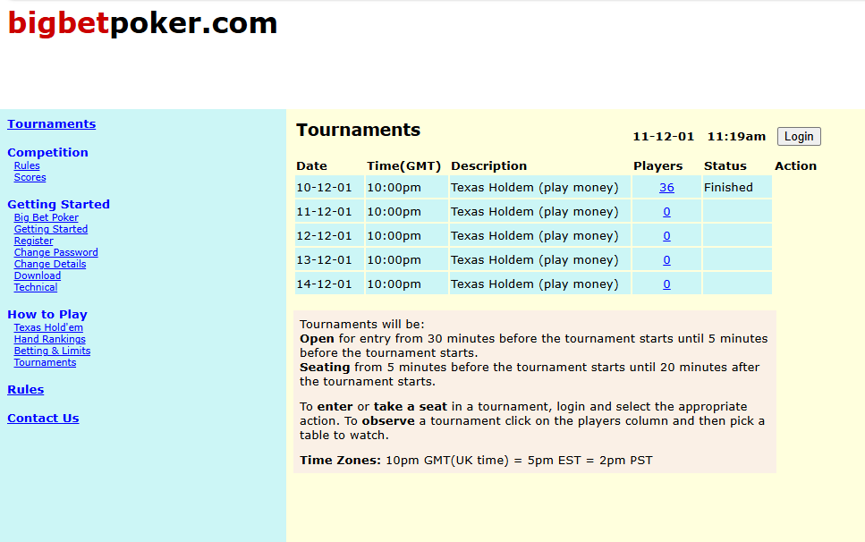
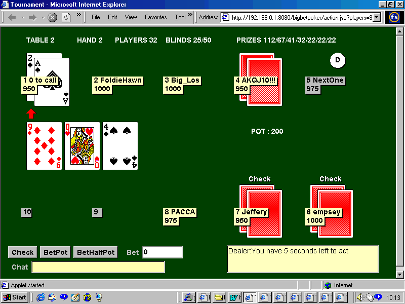

# How to Build an Online Poker Room

## tl;dr
celld and the workers API provides a new way to build robust, scaleable real-time systems without the need for bespoke infrastructure.

## Early Poker History
Internet poker started in 1998 when Planet Poker launched on a very new world wide web. At the time live poker was a minority interest, barely tolerated by the mainstream casinos, and using the internet needed a dial-up modem and a certain amount of dedication.

Planet Poker was pretty clunky, but it gained a modest following and proved that real-money poker was possible on the internet. Unfortunately, in an extraordinary act of hubris, they published their randomisation algorithm in a blog; the algorithm turned out to be easily hackable and the site faded away.

In 2000 a much more technically proficient company, Paradise Poker, got into the game and produced a slicker cardroom using the latest technology. Paradise became the clear industry leader with superior features and improved stability. 

Paradise Poker was later superceded by Party Poker, who had a much more sophisticated marketing strategy, and eventually by PokerStars, but that is another story. 

## Big Bet Poker
In the late 90s I worked as an IBM project manager for a film company in Hollywood. In my spare time I learned to play poker in the cardrooms of South LA. On returning to London I could see that the web was about to take off so decided to build a cardroom of my own, Big Bet Poker, specialising in English-style pot-limit holdem tournaments. How hard could it be?

There were fewer technology options 25 years ago than there are today. The operating system was either Windows or a brand of Unix; as a development language you could choose Java or C++; the database was either MySQL or Postgres and for real-time updates either sockets or HTTP polling.

I built a prototype play-money site on Linux using Java, MySQL and sockets. The game logic was plain old Java objects, the poker lobby was HTML and the poker table was a simple Java servlet.

About 50 people came to play poker every night and I distributed around £50 a week in prizes. 

In early 2002 a casino company based in Toronto bought the site and we set about creating a real-money poker room. The game logic had to be extended to cover limit and no-limit betting, 7 card stud and Omaha; the poker game had to be integrated with the casino back-office and a downloadable C++ client with a lobby and tables and skins had to be developed.

At this point we sat down and thought hard about the server architecture we needed to run it all.

## Poker Server Architecture
The late 90s was the Wild West for internet gambling and web-based internet casinos and sportsbooks flourished. Requirements for these sites were relatively straightforward; simple HTTP protocol could handle casino games and sports odds and the possibility of scheduled downtime meant no complex architecture was needed.

By contrast poker server requirements were much more stringent. The poker server had to be:
- **Real-time** - Player actions needed to be relayed immediately to the other players on a table; actions taking longer than 20 secs were timed out
- **Scaleable** - at the time some sites were promoting $1m tournaments; it looked like we needed to handle thousands of concurrent players
- **Robust** - poker rooms need a 'critical mass' of active tables for new players to join. Unscheduled outages, while inconvenient for a sportsbook or a casino, are a death sentence for a poker room.

If anything goes wrong on a poker table you need to restart the table in under a minute. Otherwise players will drift away and never come back.

Operations are 24/7, so rolling software updates are also needed.

Clearly we needed a multiserver setup with automatic failover. The architecture had lobby servers, table servers and a monitor listening for server heartbeats. If a server heartbeat failed, the tables were reallocated and the clients were sent a new server address.

Our servers were running in a machine room in Antigua. One evening the cleaner needed a power socket for the hoover and unplugged the freeroll table server. The tournament restarted on an adjacent machine, to our surprise and delight.

We launched in early 2003 but missed the window for cheap player acquisition. After a lacklustre start and without a huge marketing budget we struggled along for a couple years then recouped our losses by selling the software to another gaming group.

## Progress

The system as built had a number of shortcomings:
- **Process limits** - Java 1.3 needed a full process allocated for each socket. We could only run 600 players on each server; not a problem for cash games but the tournament logic was single-server.
- **Bespoke recovery mechanism** -  The recovery mechanism was not heavily tested and was probably fragile
- **Point-in-time recovery** - we could only restart to the beginning of a hand, not the last player action.
- The **Database** was a single point of failure

Over the years I have thought a lot about the game logic and infrastructure problems, and how modern technology could have helped us build a better system.

The process limit problem was well-understood and two different approaches emerged: 
- non-blocking IO 
- lightweight threads

Networked servers spend most of their time waiting for input. If each wait blocks a heavy process the server can't scale, but if the wait doesn't block then one process can handle thousands of waits. Java eventually had a non-blocking IO library, NIO, but it was difficult to use and hard to integrate with SSL.

In 2011 Ryan Dahl developed Node.js, a Javascript runtime based on an event loop and asynchronous non-blocking IO. Node.js could handle thousands of websockets in one process. In the same year Golang was announced with lightweight goroutines which could also handle the problem.

The robustness issues were harder to address. 

The Elixir language was launched in 2012. It was a new functional revamp of an old telecoms language, Erlang, and ran on BEAM, the Erlang virtual machine. The BEAM engine was designed to provide automatic recovery for programs running telecomms systems. Rather like our poker recovery code, a failed program could be restarted automatically on a new server - but all fully tested and built into the operating system.

This could have simplified our architecture. Indeed when sportsbooks needed real-time support for in-play betting some of them adopted Erlang/Elixir/BEAM. Unfortunately BEAM had a couple of downsides. First, you are swapping the problem of architecting a recovery mechanism for the problem of running a BEAM operation - it may not be so easy to find Erlang engineers in Antigua or Stoke,UK. Secondly, Erlang was primarily a telecomms system focussed on program recovery rather than data integrity. There is a BEAM specific database but setup is tricky, so it may be hard to easily fix the database single point of failure problem.

Point-in-time recovery prompted me to review the game logic. Much of the table state in the original program was buried in running java objects. A cleaner design might have separated the code from the table state. Player action handlers could retrieve the current table state, validate the incoming action, then modify, commit and broadcast the new table state. This would enable recovery to the latest action. The snag is that each action would require retrieval and storage of table state, which could overload a remote database. Ideally the state would be cached locally and stored remotely only for recovery.

In the late 2010s there was a resurgence of interest in Sqlite, which could have supported the cacheing idea. N-tier architecture had become increasingly complicated and developers like David Crawshaw began to realise that all but the very largest enterprise services could be delivered on a single server with a Sqlite database. To handle backup and recovery, Ben Johnson wrote Litestream to continuously backup Sqlite to an S3 bucket.

Then at the end of 2024 Amazon announced conditional writes for S3. This seemingly obscure announcement opened new possibilities for distributed systems architecture. Previously if you wanted to guarantee resilience for a database you had to set up duplicated databases and a complicated consensus service. The S3 conditional write lets you push down the hard bits for S3 to take care of; you can build a relatively simple system on top.

In August 2026 Ryan Dahl launched celld. He used:
- Cloudflare's Worker and Durable Objects interfaces
- Sqlite
- the LTX protocol from Litestream
- Amazon S3 or Gcloud storage 

Workers handle requests. Durable Objects and Workflows keep their state in cells, each with its own SQLite database and websocket support. Cells run on nodes and a fleet of nodes share a bucket for durable storage; a conditional bucket write assigns cell ownership. The fleet needs no membership protocol, failure detector, or consensus service.

I haven't built anything with celld yet but it looks like it can run thousands of tables on a node and restart a broken node in under 20secs with no loss of player actions, and no single point of failure.

Finally I get to scratch my 20-year itch.